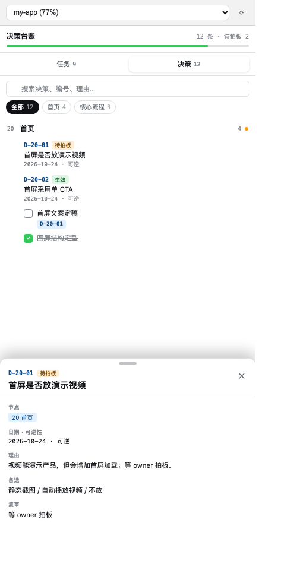
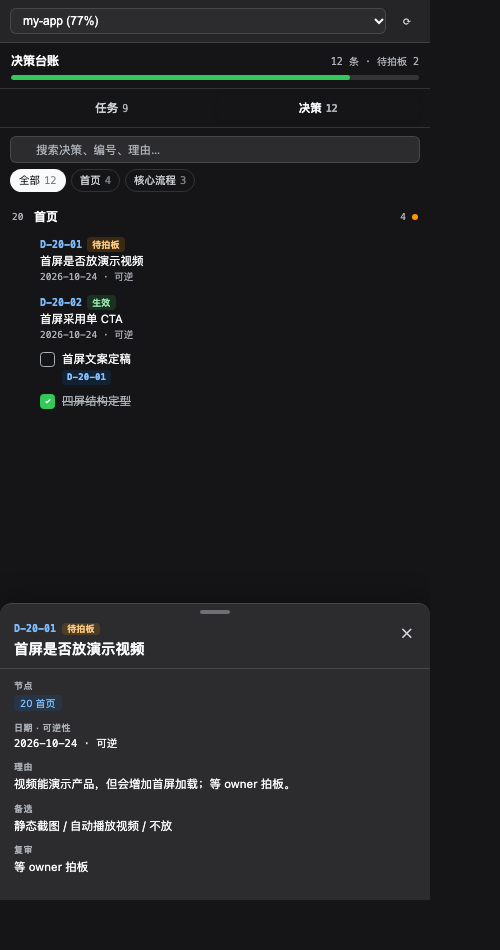

# DSH Project Board

> 把「项目结构 + 待办 + 决策」收进一套可追踪的记录系统：一棵节点树、两份文件、右侧栏一键查看。

**简体中文** | [English](#english)




## 简体中文

### 它解决什么

- 待办和决策散落在聊天、文档、看板里，过两周就找不到；
- 看板按「阶段」分节，但每天是按「产品部位」干活，找不全一个页面的上下文；
- 决策只记结论不记理由，三个月后无法判断是否还成立；
- 汇总数字手写，改一处忘一处。

这套系统用三个约束解决：

1. **节点树**：`## 20 首页`，节点 = 持久的产品面/领域，不是任务、不是阶段；
2. **双轨记录**：进度看板放任务，决策台账放决策，共用同一套节点 ID；
3. **派生视图**：进度、未完成、待拍板全部算出来，不手写。

### 右侧栏

- 索引 chips + 互斥手风琴：一次只展开一个节点；
- 搜索、仅未完成、待拍板过滤；
- 决策按节点分组，点开底部抽屉看理由/备选/影响/复审；
- 浅色 / 深色自动跟随 DSH 主题。

### 安装

### 作为 DSH 插件（推荐）

```bash
dsh plugin --profile web add @notoonex/dsh-project-board
```

> 从源码安装：`dsh plugin --profile web add github:Notoonex/dsh-project-board`

重启 DSH 后，右侧栏会出现「项目看板」。
插件会自动把 skill 安装到 `~/.dsh/skills/project-board/`，并托管本地 board server。

### 只装 Skill

在 `dsh-skills-marketplace` 里添加本仓库，稀疏路径填 `skill`。
Skill 本身不依赖插件，只要有 markdown 和 Node 就能用。

### 配置

| 环境变量 | 默认 | 说明 |
|---|---|---|
| `DSH_PROJECTS_DIR` | `~/Documents/Projects` | 项目根目录，每个子目录一个项目 |
| `DSH_PROJECT_BOARD_PORT` | 自动 | 可选；不设时从 8791 起自动找空闲端口 |

> 如果你的项目在别的目录，启动 DSH 前设置 `DSH_PROJECTS_DIR`。
> 不设端口时，server 会自动找空闲端口，前端也会自动探测，不需要手动配。

### 目录结构

```text
$DSH_PROJECTS_DIR/
└── my-app/
    ├── my-app 进度看板.md
    ├── my-app 决策台账.md
    ├── 踩坑.md            # 可选，只放教训
    └── README.md          # 可选，定位/背景
```

规则：

- 每个项目**各恰好一个** `* 进度看板.md` 和 `* 决策台账.md`；
- 两份文件 stem 必须一致，frontmatter 的 `project:` 必须等于 stem；
- 不建第三份记录，不用表格承载可勾选任务。

### 文件格式

### 进度看板

```markdown
---
schema: project-board/1
project: my-app
archetype: web-app
nodes:
  "00": 治理
  "10": 全局与架构
  "20": 首页
  "90": 归档
---

## 20 首页
> 范围：首屏 / 导航 / 视觉

- [ ] 首屏文案定稿 · 验收: 3 秒内说清产品是什么 · 关联: D-20-01
- [ ] [[首屏是否放演示视频]] 等 owner 拍板
- [x] ~~四屏结构定型~~ `abc1234`
```

### 决策台账

```markdown
---
schema: decision-log/1
project: my-app
---

### D-20-01 首屏采用单 CTA
- 节点: 20 首页
- 状态: 生效
- 日期: 2026-10-24
- 可逆性: 可逆
- 理由: 首屏只保留一个动作，降低选择成本
- 备选: 双 CTA / 无 CTA
- 影响: 20
- 复审: 上线两周看转化率
```

决策 ID 自带节点：`D-20-01` = 节点 20 的第 1 条。台账扁平按 ID 排序，天然按节点分组，不需要复制章节骨架。

### Skill

Skill 在 [`skill/`](skill/)：

- `references/init.md`：首次接入与迁移；
- `references/operate.md`：日常写任务/决策；
- `references/schema.md`：完整字段与编号规则；
- `references/packs/`：web / business / life 域包；
- `scripts/lint.mjs`：跨文件校验；
- `scripts/scan-legacy.mjs`：旧看板只读扫描，输出 mapping 草稿。

```bash
node "$DSH_SKILL_DIR/scripts/lint.mjs" "$DSH_PROJECTS_DIR/my-app"
```

### 安全

- 只监听 `127.0.0.1`，公网访问不到；
- 非本机来源的请求直接 **403**，不只是“不给读”；
- `project` 参数按目录白名单校验，拒绝路径穿越；
- 只读写项目目录内的 `* 进度看板.md` / `* 决策台账.md`；
- 勾选回写优先按任务 ID，其次按「节点 + 任务文本」定位，不依赖行号；
- 本地 token：首次启动自动生成，客户端自动携带；同一台机器上的其他页面没有 token，调用会被 401 拒绝。

### Token

- 首次启动生成 `~/.dsh/project-board/token`（权限 600）；
- 插件启动时把 token 写进已安装的 `client/client.js`；
- 客户端所有 API 请求带 `X-Project-Board-Token`；
- `/api/health` 不校验 token，只用于端口探测；
- 如果侧栏报 401：重载 DSH；或删除 token 文件后重启 DSH，让插件重新生成并注入。

> 这是**一次性自动配置**，不需要你输入任何东西。
> 只有一种情况会失败：插件安装目录本身是只读的（例如全局 npm 安装）。用 `dsh plugin add` 装到 profile 目录通常是可写的。

### 更新

- **增量更新**：只覆盖有变化的文件；
- 你新增的文件会保留；
- 你改过的文件会保留（日志提示 `kept local skill edit`）；
- 上游删除、且你没改过的文件会被删除；
- 想强制全量：删掉 `~/.dsh/skills/project-board/` 或其中的 `.manifest.json`，重启 DSH。

### 写入定位

侧栏勾选不再按行号硬写：

1. 任务有 `[T-<节点>-<序号>]` → 按 ID 找；
2. 没有 ID → 按「节点 + 任务文本」找；
3. 都找不到 → 返回 409，让前端刷新，不会误勾别的任务；
4. 勾选完成只加/去 `~~删除线~~`，不改任务原文（链接、反引号、加粗都保留）。

### 开发

```bash
npm test
```

测试包含：

- `lint` 正常/异常 fixture；
- board server 的 board/decisions API；
- 路径穿越拦截；
- CORS 远程来源拒绝 / 本地来源放行。

### 兼容

- DSH（Cordis）插件；
- 纯 markdown，Obsidian 可直接打开；
- Skill 部分对 Codex / Claude 也可复用。

### 发布

上架步骤见 [PUBLISHING.md](PUBLISHING.md)。

### License

MIT

---

## English

**DSH Project Board** turns project structure, todos and decisions into one trackable system: a node tree, two Markdown files, and a right-sidebar view.

### What it solves

- Todos and decisions are scattered across chats, docs and boards.
- Boards are grouped by phase, but you work by product surface.
- Decisions record the conclusion but not the reason.
- Summary numbers are hand-maintained and drift.

Three constraints:

1. **Node tree** — `## 20 Home`; a node is a durable product surface or domain, not a task or a phase.
2. **Two records** — the progress board holds tasks, the decision ledger holds decisions; both share node IDs.
3. **Derived views** — progress, open items and pending decisions are computed, never typed by hand.

### Right sidebar

- Index chips and an exclusive accordion: one node open at a time.
- Search, "open only" and "pending decision" filters.
- Decisions grouped by node; a bottom sheet shows reason, alternatives, impact and review.
- Light and dark modes follow the DSH theme.

### Install

As a DSH plugin (recommended):

```bash
dsh plugin --profile web add @notoonex/dsh-project-board
```

> Source install: `dsh plugin --profile web add github:Notoonex/dsh-project-board`

Restart DSH; a "Project Board" tab appears in the right sidebar. The plugin installs the bundled skill into `~/.dsh/skills/project-board/` and manages the local board server.

Skill only: add this repo to `dsh-skills-marketplace` with sparse path `skill`.

### Configuration

| Variable | Default | Description |
|---|---|---|
| `DSH_PROJECTS_DIR` | `~/Documents/Projects` | Project root; one subdirectory per project |
| `DSH_PROJECT_BOARD_PORT` | auto | Optional fixed port; otherwise 8791–8800 are probed |
| `DSH_PROJECT_BOARD_SKILL_DIR` | `~/.dsh/skills/project-board` | Advanced: override the skill install path |

### Project layout

```text
$DSH_PROJECTS_DIR/
└── my-app/
    ├── my-app 进度看板.md
    ├── my-app 决策台账.md
    ├── 踩坑.md            # optional
    └── README.md          # optional
```

The file suffixes are Chinese by design (`进度看板.md`, `决策台账.md`). The `project:` frontmatter must equal the file stem.

### File formats

### Progress board

```markdown
---
schema: project-board/1
project: my-app
archetype: web-app
nodes:
  "00": 治理
  "20": 首页
---

## 20 首页
> 范围：首屏 / 导航 / 视觉

- [ ] 首屏文案定稿 · 验收: 3 秒内说清产品是什么 · 关联: D-20-01
- [ ] [[首屏是否放演示视频]] 等 owner 拍板
- [x] ~~四屏结构定型~~ `abc1234`
```

### Decision ledger

```markdown
---
schema: decision-log/1
project: my-app
---

### D-20-01 首屏采用单 CTA
- 节点: 20 首页
- 状态: 生效
- 日期: 2026-10-24
- 可逆性: 可逆
- 理由: 首屏只保留一个动作，降低选择成本
- 备选: 双 CTA / 无 CTA
- 影响: 20
- 复审: 上线两周看转化率
```

Field names are Chinese (`节点`, `状态`, `日期`, ...) because the parser and the skill use them.

### Token

- Generated on first start at `~/.dsh/project-board/token` (mode 600).
- The plugin injects it into the installed `client/client.js`.
- Every API request carries `X-Project-Board-Token`; `/api/health` is public for port probing.
- Got a 401? Reload DSH, or delete the token file and restart DSH.
- This is a one-time automatic setup; no user input. A read-only plugin install directory is the only failure mode.

### Updates

- The bundled skill updates incrementally.
- Locally added files are kept; local edits are kept (`kept local skill edit`).
- Files removed upstream are deleted only if unedited.
- Force a full refresh by deleting `~/.dsh/skills/project-board/` or its `.manifest.json`.

### Write-back

- Task IDs `[T-<node>-<seq>]` are preferred; otherwise the server matches by node plus task text.
- If the task changed, the server returns 409 and the client refreshes; it never toggles a different task.
- Toggling done only adds or removes `~~`; links, code spans and bold are preserved.

### Security

- Listens on `127.0.0.1` only.
- A non-local `Origin` is rejected with 403.
- `project` is validated against the directory whitelist; path traversal is rejected.
- Only reads and writes `* 进度看板.md` / `* 决策台账.md` inside the project directory.
- Auto-generated token; remote pages and local pages without the token get 401.

### Development

```bash
npm test
```

Covers lint fixtures, board and decisions APIs, 401, 403, path traversal, content-based toggle and markdown preservation.

### Compatibility

- DSH (Cordis) plugin.
- Plain Markdown; opens in Obsidian.
- The skill is Markdown plus Node scripts and can be reused by other agents.

### Publishing

See [PUBLISHING.md](PUBLISHING.md).

### License

MIT
